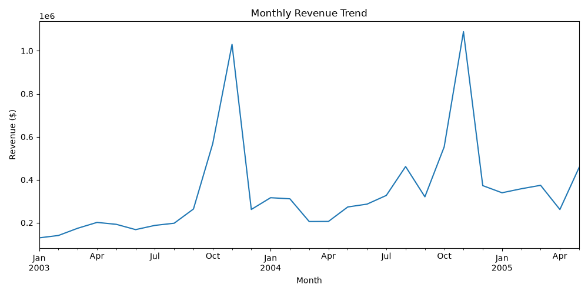
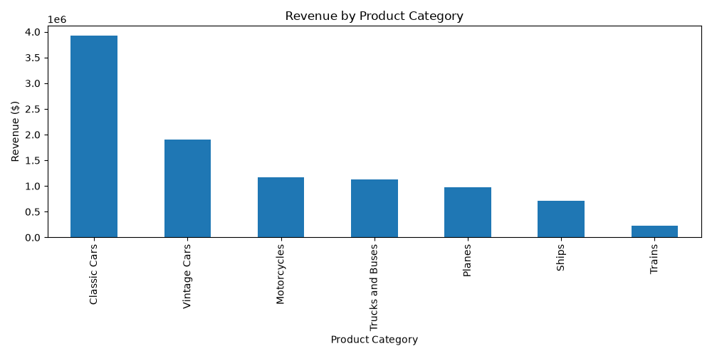
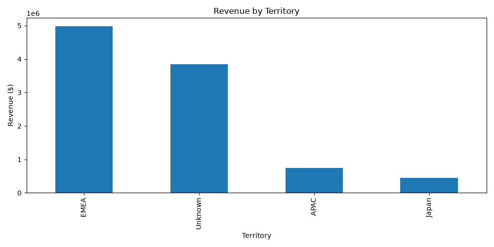

<p align="center">
  
</p>

<p align="center">
  
  
  
  
  
</p>

# Sales Insights AI

Sales Insights AI is an end-to-end sales analytics project. It starts with a reproducible data cleaning and exploratory analysis pipeline, and is being extended into a retrieval-augmented (RAG) agent that answers natural-language questions about sales performance using both computed metrics and retrieved business context.

---

## Table of Contents

- [Overview](#overview)
- [Key Findings](#key-findings)
- [Dataset](#dataset)
- [Data Pipeline](#data-pipeline)
- [Project Structure](#project-structure)
- [Getting Started](#getting-started)
- [Usage](#usage)
- [Technology Stack](#technology-stack)
- [Known Limitations](#known-limitations)
- [Roadmap](#roadmap)
- [License](#license)

---

## Overview

Sales data is often fragmented and difficult for non-technical stakeholders to query directly. This project addresses that problem in three stages:

| Stage | Description | Status |
|-------|-------------|--------|
| 1. Data Foundation | Clean, standardize and validate raw transactional data | Complete |
| 2. Analysis | Identify revenue trends by time, product and territory | In progress |
| 3. Intelligence Layer | RAG pipeline and LLM agent for plain-English queries, served via a dashboard | Planned |

---

## Key Findings

Figures below are computed from `data/sales_data_clean.csv` (2,823 order lines, January 2003 to May 2005, total revenue of approximately **$10.03M**).

### Revenue by Month

<p align="center"></p>

- November is the strongest month by a wide margin, generating **$2.12M**, roughly 21% of all revenue in the dataset.
- October (**$1.12M**) is the second-highest month, indicating a pronounced Q4 seasonal peak.
- June is the weakest month at **$0.45M**.

### Revenue by Product Category

<p align="center"></p>

| Product Category | Revenue (USD) |
|------------------|--------------:|
| Classic Cars | 3,919,616 |
| Vintage Cars | 1,903,151 |
| Motorcycles | 1,166,388 |
| Trucks and Buses | 1,127,790 |
| Planes | 975,004 |
| Ships | 714,437 |
| Trains | 226,243 |

Classic Cars alone account for approximately 39% of total revenue.

### Revenue by Territory

<p align="center"></p>

| Territory | Revenue (USD) |
|-----------|--------------:|
| EMEA | 4,979,272 |
| Unknown (North America, see [Known Limitations](#known-limitations)) | 3,852,061 |
| APAC | 746,122 |
| Japan | 455,173 |

---

## Dataset

| Attribute | Detail |
|-----------|--------|
| Source | [Sample Sales Data, Kaggle](https://www.kaggle.com/datasets/kyanyoga/sample-sales-data) |
| Records | 2,823 order lines across 307 orders |
| Customers | 92 customers in 19 countries |
| Period | January 2003 to May 2005 |
| Original columns | 25 |
| Columns retained | 15 |

---

## Data Pipeline

### Issues in the raw data

The raw file (`data/raw/sales_data_raw.csv`) required the following corrections:

- Dates stored as text (for example `2/24/2003 0:00`) rather than as date values
- Non-UTF-8 encoding, requiring `ISO-8859-1` to load correctly
- Address and contact columns that are not relevant to sales analysis
- Blank `TERRITORY` values for approximately 38% of rows

### Cleaning steps (`src/clean_data.py`)

1. Select the 15 columns relevant to sales analysis
2. Parse `ORDERDATE` into a proper datetime column
3. Fill missing territory values with `Unknown` rather than dropping rows
4. Trim whitespace in country and product line fields
5. Rename all columns to lowercase `snake_case`
6. Validate for remaining null values and write `data/sales_data_clean.csv`

The raw file is never modified; all output is written to a separate file.

### Output schema

| Column | Type | Description |
|--------|------|-------------|
| `order_id` | int | Order number |
| `order_date` | datetime | Date the order was placed |
| `quantity` | int | Units ordered |
| `unit_price` | float | Price per unit |
| `revenue` | float | Line revenue |
| `status` | str | Order status (Shipped, Cancelled, etc.) |
| `product_category` | str | Product line |
| `product_code` | str | Product identifier |
| `customer_name` | str | Customer |
| `country` | str | Customer country |
| `territory` | str | Sales territory |
| `deal_size` | str | Small, Medium or Large |
| `quarter` | int | Fiscal quarter |
| `month` | int | Month number |
| `year` | int | Year |

---

## Project Structure

```
sales-insights-ai/
├── assets/
│   └── banner.svg                 # README banner
├── data/
│   ├── raw/
│   │   └── sales_data_raw.csv     # original Kaggle download (read-only)
│   └── sales_data_clean.csv       # cleaned, analysis-ready data
├── notebooks/
│   ├── monthly_revenue.png        # monthly revenue chart
│   ├── product_revenue.png        # revenue by product category chart
│   └── territory_revenue.png      # revenue by territory chart
├── src/
│   ├── explore_data.py            # initial inspection of the raw data
│   ├── clean_data.py              # cleaning pipeline
│   └── analysis.py                # revenue analysis
├── .gitignore
└── README.md
```

---

## Getting Started

### Prerequisites

- Python 3.10 or later
- Git

### Installation

```bash
git clone https://github.com/vanshikatandxn/sales-insights-ai.git
cd sales-insights-ai

python -m venv venv
venv\Scripts\activate          # Windows
source venv/bin/activate       # macOS / Linux

pip install pandas matplotlib jupyter openpyxl
```

---

## Usage

Scripts use paths relative to `src/`, so run them from inside that directory:

```bash
cd src

python explore_data.py    # inspect shape, types, nulls and duplicates in the raw data
python clean_data.py      # produce data/sales_data_clean.csv
python analysis.py        # run the revenue analysis
```

---

## Technology Stack

| Layer | Technology | Status |
|-------|------------|--------|
| Data processing | Python, pandas | In use |
| Visualization | matplotlib | In use |
| Retrieval | Vector database and embeddings | Planned |
| Agent | Claude / LLM API | Planned |
| Interface | Streamlit | Planned |

---

## Known Limitations

- **North America is reported as `Unknown`.** The raw dataset uses the code `NA` for North America, which pandas interprets as a missing value by default. All 1,074 rows labelled `Unknown` belong to the USA and Canada. Loading the raw file with `keep_default_na=False` (or mapping these rows to `NA`) will restore the correct territory.
- The dataset ends in May 2005, so 2005 figures cover a partial year and should not be compared directly with full years.
- Revenue figures include all order statuses, including cancelled and on-hold orders.

---

## Roadmap

- [x] Environment setup
- [x] Acquire source sales data
- [x] Clean and structure the data
- [x] Monthly, product category and territory revenue analysis
- [ ] Correct North America territory labelling
- [ ] Interactive dashboard
- [ ] RAG pipeline over sales notes and business context
- [ ] AI agent for natural-language sales queries

---

## License

This project is released under the MIT License.